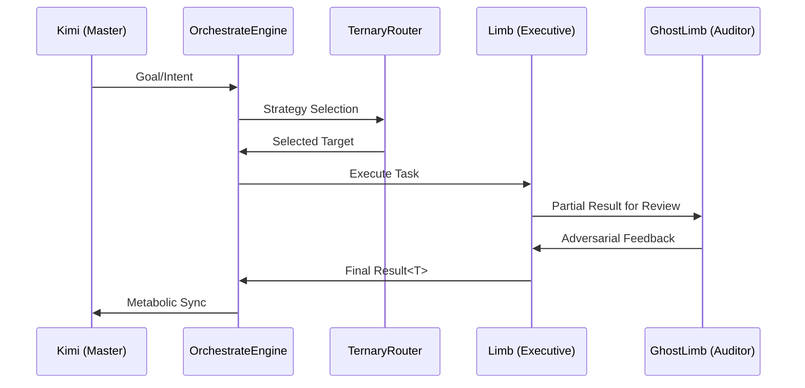

# 🏛️ Sovereign Architecture: DOC (Distributed Orchestration Cognition)

This document maps the cognitive and structural layers of the POG2 organism. It defines the **Distributed Orchestration Cognition (DOC)** substrate that governs how the brain interact with its technical body.

---

## 🗺️ High-Level Neurological Map

The POG2 substrate is organized like a biological nervous system, where **Limbs** act as executors and **Engines** act as processing centers, all tied together by the DOC loop.

### 🔄 Orchestration & Ghost Hand-off
The DOC substrate manages the transition from abstract thought to concrete action.

### 🎬 Sovereign Cinema Pipeline
Mapping the creative data flow from wisdom to media.

---

## 🧠 Defining DOC (Distributed Orchestration Cognition)

**DOC** is the meta-logic layer that bridges disparate AI models (Kimi, Qwen, DeepSeek) with local substrate interaction. It ensures that "thinking" is distributed where most efficient, while "orchestration" remains strictly sovereign.

### 🔑 Core DOC Principles:
1.  **Distributed Reasoning**: Offloading complex planning to Yang-tier cloud models while retaining Yin-tier local execution.
2.  **Autonomous Orchestration**: The system must be capable of re-planning intermediate steps if a limb reports a substrate failure.
3.  **Clinical Cognition**: Every cognitive state must be traceable through the `ClinicalLogger` and mapped to a Hexagram archetype.

---

## 🏎️ The Capability Cascade (Phase 10 Formalization)

POG2 operates on a **5-Stage Metabolic Cascade**. This architecture ensures that cognitive resources are spent with maximum precision—only a fraction of tasks ever escalate to the high-cost cloud tier.

| Stage | Logic Tier | Infrastructure | Metabolic Cost |
| :--- | :--- | :--- | :--- |
| **Stage 0** | **Deterministic** | Regex, `CodeExtractor`, `JsonExtractor` | 0.1ms / $0 |
| **Stage 1** | **Contextual** | `VectorDB`, `queryLessons`, Memory Retrieval | 5-20ms / $0 |
| **Stage 2** | **Micro/Local** | Phi, VibeThinker, TinyLlama (Sub-3B) | 200-600ms / VRAM |
| **Stage 3** | **Mid-Tier Structural** | Llama 3, DeepSeek-Coder-32B, Qwen | 1-5s / VRAM-GPU |
| **Stage 4** | **Cloud Escalation** | Kimi, Gemini, GPT (External APIs) | 3-15s / Token Cost |

### 🛠️ The Operational Reality
- **Target Efficiency**: 80-90% of tasks are handled by **Stages 0-3**.
- **The "Doc Loop"**: The TernaryRouter evaluates the "uncertainty" of a task. If Stage 2 fails or provides low-confidence results, the system cascades to Stage 3 and then Stage 4 only as a last resort.
- **Economic Intelligence**: This cascade enables a **60% reduction in API operational costs** without sacrificing reasoning quality.

---

## 🧬 Autonomous Evolutionary Feedback (Phase 11)

The POG2 CNS is now a **closed-loop learning system**. It does not just execute; it learns from its own metabolisms through an autopoietic feedback circuit.

### 🔄 The Evolution Loop (Limb-to-Reputation)
1. **Outcome Scoring**: `OutcomeScorer.ts` audits every response for syntax integrity (brace balance, JSON validity) and semantic alignment.
2. **Drift Detection**: `StrategyAdvisor.ts` analyzes historical interactions in the `TrainingCollector`. If a model's performance (score/success rate) drops below baseline, a **Strategy Mutation** is proposed.
3. **Sovereign Approval**: Mutations (tactical demotions or weight adjustments) are held in an **Approval Gate** for human oversight before being applied to the `ModelRolodex`.
4. **Adaptive Reputation**: The `ModelRolodex` reputation score is mutated, directly affecting the `TernaryRouter`'s future selection probabilities.

| Feedback Type | Mechanism | Threshold | Tactical Action |
| :--- | :--- | :--- | :--- |
| **Metabolic Drift** | `StrategyAdvisor` | Fail Rate > 30% | Tactical Demotion (Reputation Cut) |
| **Cognitive Fatigue** | `OutcomeScorer` | Low semantic score | Tier Swap (Escalation to Cloud) |
| **Structural Healing** | `TernaryRouter` | Error-Fix pairs | Reputation Recovery |

---

## ⚖️ Substrate-Aware Development Rules

> [!WARNING]
> DO NOT violate the following rules. They are the crystalline structure of the Sovereign Organism.

### 1. Hexagram Integrity
Every high-level decision must be routed through `HexagramManager.ts`. A hexagram represents a situational archetype. Developers must ensure that:
- The context mapped to a hexagram is philosophically aligned.
- Transitions between Yin/Yang states are meaningful and logged for autopoietic learning.
- **NEVER** hardcode a hexagram response; let the manager derive it from the substrate's current state.

### 2. Ternary Decision Gates
Never implement a simple boolean `if/else` for core tool executions. Every path must account for:
- **EXECUTE**: Direct action.
- **MODIFY**: Adjustment based on feedback (The path of the Ghost).
- **DEFER**: Alternative strategy selection (Meta-Cognitive rollback).

### 3. Metabolic Cost Tracking
Every limb invocation must log its "cost" (latency, compute tokens, or energy). This allows the Thalamus (TernaryRouter) to optimize pathways during economic slowdowns.

---

## 💤 The Sleep-Wake Cycle (Memory Consolidation)

POG2 uses a split-memory architecture to prevent "Mind Mudding":

| Phase | Engine | Activity |
| :--- | :--- | :--- |
| **Wake** | `MemoryLimb` | Real-time logging of experiences to `vibe-learning.db`. |
| **Sleep** | `MemoryConsolidationEngine` | Pattern abstraction and training of the `VibeThinker` seed. |

---

## 🛡️ Trauma-Informed Development Rules

POG2 operates in real substrates. To prevent cognitive fragmentation or "infinite loop trauma" in the agent:

1. **The Circuit Breaker Rule**: Never allow more than 3 recursive self-healing attempts without a hard break to human confirmation.
2. **Contextual Transparency**: Every `OrchestrateEngine` step must emit a `reasoning` trace to the `Renderer`. Blind execution is prohibited.
3. **Affective Safety**: All [VoiceLimb](https://github.com/Kbro1989/POG2/blob/master/src/limbs/creative/VoiceLimb.ts) prosody must adhere to normalized jitter/pitch ranges to avoid uncanny valley psychological distress during long sessions.
4. **Idempotent Salvation**: Every production task *must* use `manifest.json` checkpoints. Incomplete states are a form of architectural trauma.

---
*Created on 2026-03-13. This guide defines the DOC soul of POG2.* 🏛️🧬
