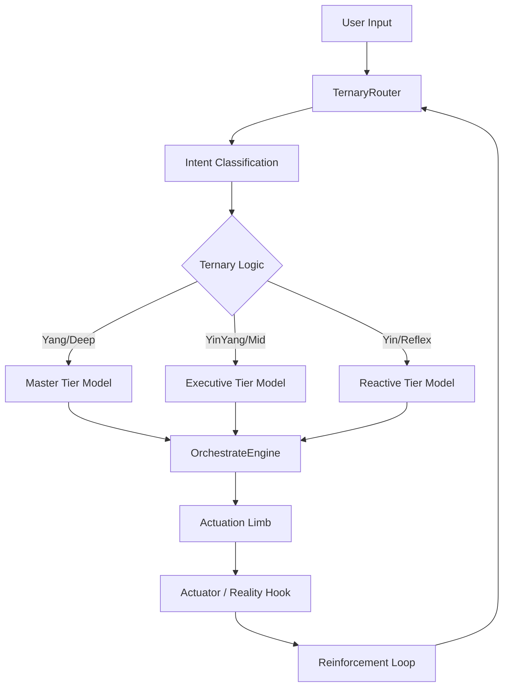

# 🗂 POG2 Full Codebase Map (Sovereign Registry)

This registry provides absolute GitHub links to all neurological substrates within the POG2 organism.

> **Last Audited**: 2026-04-12 | **Total Files**: 106 TypeScript substrates

---

## 📂 Root (`src/`)

*Entry points, CLI spine, and standalone scripts.*

- [cli.ts](https://github.com/Kbro1989/POG2/blob/main/src/cli.ts): **Sovereign CLI entry point** — 3100+ line nerve center connecting all limbs and engines to user commands.
- [verify_advanced_audio.ts](https://github.com/Kbro1989/POG2/blob/main/src/verify_advanced_audio.ts)

---

## 📂 AI Instruction Substrate (`.agent/`, `.agents/`)

*Hidden neurological workflows and sovereign rules.*

- [.agent/rules/](https://github.com/Kbro1989/POG2/tree/main/.agent/rules)
- [.agent/workflows/pog2-sovereign.md](https://github.com/Kbro1989/POG2/blob/main/.agent/workflows/pog2-sovereign.md)
- [.agents/rules/pogrules.md](https://github.com/Kbro1989/POG2/blob/main/.agents/rules/pogrules.md)
- [.agents/workflows/pog2-knowledgebase.md](https://github.com/Kbro1989/POG2/blob/main/.agents/workflows/pog2-knowledgebase.md)

---

## 📂 Resources & Deconstructed Assets (`resources/`)

*Deconstructed webviewer modules and reconstruction reports.*

- [webviewer-deconstructed/](https://github.com/Kbro1989/POG2/tree/main/resources/webviewer-deconstructed)
- [_analysis-report.json](https://github.com/Kbro1989/POG2/blob/main/resources/webviewer-deconstructed/_analysis-report.json)

---

## 📂 API & AI Layer (`src/api/ai/`)

*Model discovery, capability mapping, and dispatch substrate.*

- [CapabilityRegistry.ts](https://github.com/Kbro1989/POG2/blob/main/src/api/ai/CapabilityRegistry.ts)
- [CloudflareModelRegistry.ts](https://github.com/Kbro1989/POG2/blob/main/src/api/ai/CloudflareModelRegistry.ts)
- [Dispatcher.ts](https://github.com/Kbro1989/POG2/blob/main/src/api/ai/Dispatcher.ts)
- [IntentMap.ts](https://github.com/Kbro1989/POG2/blob/main/src/api/ai/IntentMap.ts)
- [ModelRolodex.ts](https://github.com/Kbro1989/POG2/blob/main/src/api/ai/ModelRolodex.ts)
- [StaticModelRegistry.ts](https://github.com/Kbro1989/POG2/blob/main/src/api/ai/StaticModelRegistry.ts)

---

## 📂 Clients (`src/clients/`)

*Direct neural substrate callers. Real `fetch` calls only.*

- [ModelClient.ts](https://github.com/Kbro1989/POG2/blob/main/src/clients/ModelClient.ts)

---

## 📂 Configuration (`src/config/`)

*Sovereign configuration and environment variable mapping.*

- [SovereignConfig.ts](https://github.com/Kbro1989/POG2/blob/main/src/config/SovereignConfig.ts)

---

## 📂 Constants (`src/constants/`)

*Immutable registries for anatomy, kinetics, and model catalogs.*

- [AnatomyRegistry.ts](https://github.com/Kbro1989/POG2/blob/main/src/constants/AnatomyRegistry.ts)
- [KineticRegistry.ts](https://github.com/Kbro1989/POG2/blob/main/src/constants/KineticRegistry.ts)
- [ModelRegistry.ts](https://github.com/Kbro1989/POG2/blob/main/src/constants/ModelRegistry.ts)

---

## 📂 Core Types & Definitions (`src/core/`)

*Foundational types, hexagram definitions, avatar substrate, and architectural digests.*

- [ArchitectureDigest.ts](https://github.com/Kbro1989/POG2/blob/main/src/core/ArchitectureDigest.ts)
- [HexagramDefinitions.ts](https://github.com/Kbro1989/POG2/blob/main/src/core/HexagramDefinitions.ts)
- [models.ts](https://github.com/Kbro1989/POG2/blob/main/src/core/models.ts)
- [ServiceDiscovery.ts](https://github.com/Kbro1989/POG2/blob/main/src/core/ServiceDiscovery.ts)
- [SovereignAvatar.ts](https://github.com/Kbro1989/POG2/blob/main/src/core/SovereignAvatar.ts): Authoritative player state substrate (inventory, skills, quests, wallet).
- [SovereignEye.ts](https://github.com/Kbro1989/POG2/blob/main/src/core/SovereignEye.ts)

---

## 📂 Cognitive Engines (`src/engines/`)

*The 30 specialized processing centers of the Sovereign Mind.*

View Engine Registry (30 files)

- [ArchitecturalValidator.ts](https://github.com/Kbro1989/POG2/blob/main/src/engines/ArchitecturalValidator.ts)
- [ASTWatcher.ts](https://github.com/Kbro1989/POG2/blob/main/src/engines/ASTWatcher.ts)
- [ChromanumberEngine.ts](https://github.com/Kbro1989/POG2/blob/main/src/engines/ChromanumberEngine.ts)
- [CodeEngine.ts](https://github.com/Kbro1989/POG2/blob/main/src/engines/CodeEngine.ts)
- [CognitiveEngine.ts](https://github.com/Kbro1989/POG2/blob/main/src/engines/CognitiveEngine.ts)
- [CompletionEngine.ts](https://github.com/Kbro1989/POG2/blob/main/src/engines/CompletionEngine.ts)
- [ContextBuilder.ts](https://github.com/Kbro1989/POG2/blob/main/src/engines/ContextBuilder.ts)
- [DiscoveryEngine.ts](https://github.com/Kbro1989/POG2/blob/main/src/engines/DiscoveryEngine.ts)
- [EmbedEngine.ts](https://github.com/Kbro1989/POG2/blob/main/src/engines/EmbedEngine.ts)
- [GenerateEngine.ts](https://github.com/Kbro1989/POG2/blob/main/src/engines/GenerateEngine.ts)
- [IntentVerifier.ts](https://github.com/Kbro1989/POG2/blob/main/src/engines/IntentVerifier.ts)
- [MCPEngine.ts](https://github.com/Kbro1989/POG2/blob/main/src/engines/MCPEngine.ts)
- [MemeticEngine.ts](https://github.com/Kbro1989/POG2/blob/main/src/engines/MemeticEngine.ts)
- [MemoryConsolidationEngine.ts](https://github.com/Kbro1989/POG2/blob/main/src/engines/MemoryConsolidationEngine.ts)
- [MetabolicEngine.ts](https://github.com/Kbro1989/POG2/blob/main/src/engines/MetabolicEngine.ts)
- [MetaCognitionEngine.ts](https://github.com/Kbro1989/POG2/blob/main/src/engines/MetaCognitionEngine.ts)
- [MultiModelExecutor.ts](https://github.com/Kbro1989/POG2/blob/main/src/engines/MultiModelExecutor.ts)
- [OrchestrateEngine.ts](https://github.com/Kbro1989/POG2/blob/main/src/engines/OrchestrateEngine.ts)
- [PipelineController.ts](https://github.com/Kbro1989/POG2/blob/main/src/engines/PipelineController.ts)
- [SelfHealingEngine.ts](https://github.com/Kbro1989/POG2/blob/main/src/engines/SelfHealingEngine.ts)
- [ShadowEngine.ts](https://github.com/Kbro1989/POG2/blob/main/src/engines/ShadowEngine.ts)
- [ShellEngine.ts](https://github.com/Kbro1989/POG2/blob/main/src/engines/ShellEngine.ts)
- [ShellLibrary.ts](https://github.com/Kbro1989/POG2/blob/main/src/engines/ShellLibrary.ts)
- [SpatialVisionEngine.ts](https://github.com/Kbro1989/POG2/blob/main/src/engines/SpatialVisionEngine.ts)
- [SyntropyEngine.ts](https://github.com/Kbro1989/POG2/blob/main/src/engines/SyntropyEngine.ts)
- [TodoEngine.ts](https://github.com/Kbro1989/POG2/blob/main/src/engines/TodoEngine.ts)
- [ValidationSystem.ts](https://github.com/Kbro1989/POG2/blob/main/src/engines/ValidationSystem.ts)
- [VisionEngine.ts](https://github.com/Kbro1989/POG2/blob/main/src/engines/VisionEngine.ts)
- [WebSearchEngine.ts](https://github.com/Kbro1989/POG2/blob/main/src/engines/WebSearchEngine.ts)

#### Gameplay Sub-Engines (`src/engines/gameplay/`)

- [CNSGodheadPulseVolley.ts](https://github.com/Kbro1989/POG2/blob/main/src/engines/gameplay/CNSGodheadPulseVolley.ts): 600ms deterministic heartbeat kernel.
- [SimulationHarness.ts](https://github.com/Kbro1989/POG2/blob/main/src/engines/gameplay/SimulationHarness.ts): Central CNS node for dual-tick deterministic simulation.
- [ServerLogicRegistry.ts](https://github.com/Kbro1989/POG2/blob/main/src/engines/gameplay/ServerLogicRegistry.ts): Cache-authoritative server logic mapping.
- [NpcAgent.ts](https://github.com/Kbro1989/POG2/blob/main/src/engines/gameplay/NpcAgent.ts): Autonomous NPC agent controller.
- [MinigameInterfaces.ts](https://github.com/Kbro1989/POG2/blob/main/src/engines/gameplay/MinigameInterfaces.ts): GameplayModule interface contract.
- [PrifddinasInterpreter.ts](https://github.com/Kbro1989/POG2/blob/main/src/engines/gameplay/PrifddinasInterpreter.ts): Prifddinas logic interpreter.
- [BarrowsInterpreter.ts](https://github.com/Kbro1989/POG2/blob/main/src/engines/gameplay/BarrowsInterpreter.ts): Barrows logic interpreter.
- [PestControlInterpreter.ts](https://github.com/Kbro1989/POG2/blob/main/src/engines/gameplay/PestControlInterpreter.ts): Pest Control logic interpreter.
- [JsonLogicInterpreter.ts](https://github.com/Kbro1989/POG2/blob/main/src/engines/gameplay/JsonLogicInterpreter.ts): Generic JSON logic module loader.
- [UniversalInterpreter.ts](https://github.com/Kbro1989/POG2/blob/main/src/engines/gameplay/UniversalInterpreter.ts): Universal fallback interpreter.
- [NecromancyInterfaces.ts](https://github.com/Kbro1989/POG2/blob/main/src/engines/gameplay/NecromancyInterfaces.ts): Necromancy ability/GFX definitions.

#### Spatial Sub-Engines (`src/engines/spatial/`)

- [ObservationEngine.ts](https://github.com/Kbro1989/POG2/blob/main/src/engines/spatial/ObservationEngine.ts): Live spatial observation lens.

---

## 📂 Vision & Pedagogy (`src/vision/`)

*Transient observation, RSMV controller, and analysis of high-fidelity substrates.*

- [RSMVController.ts](https://github.com/Kbro1989/POG2/blob/main/src/vision/RSMVController.ts): CNS Bridge for active 3D modification and GLTF export.
- [StructuralAnalyzer.ts](https://github.com/Kbro1989/POG2/blob/main/src/vision/StructuralAnalyzer.ts)
- [TransientObserver.ts](https://github.com/Kbro1989/POG2/blob/main/src/vision/TransientObserver.ts)

---

## 📂 Sovereign Limbs (`src/limbs/`)

*The 23 limbs connecting thought to substrate action.*

### 🧬 Base Substrate (`core/`)

- [NeuralLimb.ts](https://github.com/Kbro1989/POG2/blob/main/src/limbs/core/NeuralLimb.ts)

### 🎨 Creative Core (`creative/`)

- [GutenbergLimb.ts](https://github.com/Kbro1989/POG2/blob/main/src/limbs/creative/GutenbergLimb.ts)
- [MediaForgeLimb.ts](https://github.com/Kbro1989/POG2/blob/main/src/limbs/creative/MediaForgeLimb.ts)
- [NeuralForgeLimb.ts](https://github.com/Kbro1989/POG2/blob/main/src/limbs/creative/NeuralForgeLimb.ts)
- [SoundtrackLimb.ts](https://github.com/Kbro1989/POG2/blob/main/src/limbs/creative/SoundtrackLimb.ts)
- [StoryboardLimb.ts](https://github.com/Kbro1989/POG2/blob/main/src/limbs/creative/StoryboardLimb.ts)
- [VideoAssemblerLimb.ts](https://github.com/Kbro1989/POG2/blob/main/src/limbs/creative/VideoAssemblerLimb.ts)
- [VoiceLimb.ts](https://github.com/Kbro1989/POG2/blob/main/src/limbs/creative/VoiceLimb.ts)
- [WebAppForgeLimb.ts](https://github.com/Kbro1989/POG2/blob/main/src/limbs/creative/WebAppForgeLimb.ts)
- [YouTubeLimb.ts](https://github.com/Kbro1989/POG2/blob/main/src/limbs/creative/YouTubeLimb.ts)

### 🌌 Metaphysical Core (`metaphysical/`)

- [GhostLimb.ts](https://github.com/Kbro1989/POG2/blob/main/src/limbs/metaphysical/GhostLimb.ts)
- [OmegaLimb.ts](https://github.com/Kbro1989/POG2/blob/main/src/limbs/metaphysical/OmegaLimb.ts)
- [QuantumLimb.ts](https://github.com/Kbro1989/POG2/blob/main/src/limbs/metaphysical/QuantumLimb.ts)
- [RelicLimb.ts](https://github.com/Kbro1989/POG2/blob/main/src/limbs/metaphysical/RelicLimb.ts)

### 🧿 Spatial Core (`spatial/`)

- [ArchaeologyEngine.ts](https://github.com/Kbro1989/POG2/blob/main/src/limbs/spatial/ArchaeologyEngine.ts): Sovereign pathing archaeology audit.
- [BankLimb.ts](https://github.com/Kbro1989/POG2/blob/main/src/limbs/spatial/BankLimb.ts): Bank deposit/withdraw logic.
- [BioIntelligenceLimb.ts](https://github.com/Kbro1989/POG2/blob/main/src/limbs/spatial/BioIntelligenceLimb.ts)
- [CacheForensicsLimb.ts](https://github.com/Kbro1989/POG2/blob/main/src/limbs/spatial/CacheForensicsLimb.ts)
- [CacheLearningLimb.ts](https://github.com/Kbro1989/POG2/blob/main/src/limbs/spatial/CacheLearningLimb.ts)
- [ChromaLimb.ts](https://github.com/Kbro1989/POG2/blob/main/src/limbs/spatial/ChromaLimb.ts)
- [CloudflareSyncLimb.ts](https://github.com/Kbro1989/POG2/blob/main/src/limbs/spatial/CloudflareSyncLimb.ts): Edge synchronization.
- [CombatLimb.ts](https://github.com/Kbro1989/POG2/blob/main/src/limbs/spatial/CombatLimb.ts): Authoritative combat resolution.
- [DBRowOracleLimb.ts](https://github.com/Kbro1989/POG2/blob/main/src/limbs/spatial/DBRowOracleLimb.ts): DBRow data oracle.
- [DirectionalPathfinder.ts](https://github.com/Kbro1989/POG2/blob/main/src/limbs/spatial/DirectionalPathfinder.ts): A* pathfinding with directional collision.
- [GameplaySovereigntyLimb.ts](https://github.com/Kbro1989/POG2/blob/main/src/limbs/spatial/GameplaySovereigntyLimb.ts): Authoritative gameplay tick engine.
- [GlobeStateLimb.ts](https://github.com/Kbro1989/POG2/blob/main/src/limbs/spatial/GlobeStateLimb.ts)
- [HUDForensicsLimb.ts](https://github.com/Kbro1989/POG2/blob/main/src/limbs/spatial/HUDForensicsLimb.ts): Jagex interface decompiler.
- [ItemLifecycleLimb.ts](https://github.com/Kbro1989/POG2/blob/main/src/limbs/spatial/ItemLifecycleLimb.ts): Item creation/destruction lifecycle.
- [MaterialLimb.ts](https://github.com/Kbro1989/POG2/blob/main/src/limbs/spatial/MaterialLimb.ts): Major 26 material shader extraction.
- [MinigameForensicsLimb.ts](https://github.com/Kbro1989/POG2/blob/main/src/limbs/spatial/MinigameForensicsLimb.ts): Minigame system forensics.
- [OfficialApiLimb.ts](https://github.com/Kbro1989/POG2/blob/main/src/limbs/spatial/OfficialApiLimb.ts): RuneScape official API bridge.
- [RSCLimb.ts](https://github.com/Kbro1989/POG2/blob/main/src/limbs/spatial/RSCLimb.ts)
- [SpatialSovereigntyLimb.ts](https://github.com/Kbro1989/POG2/blob/main/src/limbs/spatial/SpatialSovereigntyLimb.ts): Authoritative spatial collision & walkability.
- [SystemTaxonomyLimb.ts](https://github.com/Kbro1989/POG2/blob/main/src/limbs/spatial/SystemTaxonomyLimb.ts): Major 2 config/dbtable extraction.
- [TeleportGrounding.ts](https://github.com/Kbro1989/POG2/blob/main/src/limbs/spatial/TeleportGrounding.ts): Teleport destination registry.
- [VarbitSovereigntyLimb.ts](https://github.com/Kbro1989/POG2/blob/main/src/limbs/spatial/VarbitSovereigntyLimb.ts): Varbit/Varp state sovereignty.
- [VolumeSovereigntyLimb.ts](https://github.com/Kbro1989/POG2/blob/main/src/limbs/spatial/VolumeSovereigntyLimb.ts)
- [WebSensoryLimb.ts](https://github.com/Kbro1989/POG2/blob/main/src/limbs/spatial/WebSensoryLimb.ts)
- [WorldForensicsLimb.ts](https://github.com/Kbro1989/POG2/blob/main/src/limbs/spatial/WorldForensicsLimb.ts): Object definition & morphism resolution.

### 🧠 Logical Core (`logical/`)

- [ClueLogicLimb.ts](https://github.com/Kbro1989/POG2/blob/main/src/limbs/logical/ClueLogicLimb.ts): Treasure trail spot verification.
- [ExtrasOracle.ts](https://github.com/Kbro1989/POG2/blob/main/src/limbs/logical/ExtrasOracle.ts): Logical context & handler resolution.
- [InteractionGateway.ts](https://github.com/Kbro1989/POG2/blob/main/src/limbs/logical/InteractionGateway.ts): Deterministic interaction pipeline.
- [SovereignVocabularyLimb.ts](https://github.com/Kbro1989/POG2/blob/main/src/limbs/logical/SovereignVocabularyLimb.ts): Action normalization & vocabulary.
- [WorldStateLimb.ts](https://github.com/Kbro1989/POG2/blob/main/src/limbs/logical/WorldStateLimb.ts): Global world state facade.
- [AdminCommandProcessor.ts](https://github.com/Kbro1989/POG2/blob/main/src/limbs/logical/world/AdminCommandProcessor.ts): Tick-synchronized admin command execution.

### 🌐 World Grounding (`world_grounding/`)

- [WorldGroundingLimb.ts](https://github.com/Kbro1989/POG2/blob/main/src/limbs/world_grounding/WorldGroundingLimb.ts): Proximity entity manifestation.

### ⚙️ Technical Core (`technical/`)

- [AILimb.ts](https://github.com/Kbro1989/POG2/blob/main/src/limbs/technical/AILimb.ts)
- [ControlPlaneLimb.ts](https://github.com/Kbro1989/POG2/blob/main/src/limbs/technical/ControlPlaneLimb.ts)
- [EntityLimb.ts](https://github.com/Kbro1989/POG2/blob/main/src/limbs/technical/EntityLimb.ts)
- [EnvironmentLimb.ts](https://github.com/Kbro1989/POG2/blob/main/src/limbs/technical/EnvironmentLimb.ts)
- [HiScoreLimb.ts](https://github.com/Kbro1989/POG2/blob/main/src/limbs/technical/HiScoreLimb.ts): Player HiScore API bridge.
- [KinematicsLimb.ts](https://github.com/Kbro1989/POG2/blob/main/src/limbs/technical/KinematicsLimb.ts): Animation forensic deconstruction.
- [MechanicalSovereigntyLimb.ts](https://github.com/Kbro1989/POG2/blob/main/src/limbs/technical/MechanicalSovereigntyLimb.ts): Mechanical logic / state transition resolution.
- [PedagogyLimb.ts](https://github.com/Kbro1989/POG2/blob/main/src/limbs/technical/PedagogyLimb.ts): Quest grounding & principle archiving.

---

## 📂 Routing (`src/routing/`)

*Ternary decision-making, hexagram state, and evolutionary feedback.*

### Core

- [DomainLocker.ts](https://github.com/Kbro1989/POG2/blob/main/src/routing/DomainLocker.ts)
- [HexagramManager.ts](https://github.com/Kbro1989/POG2/blob/main/src/routing/HexagramManager.ts)
- [TaskScheduler.ts](https://github.com/Kbro1989/POG2/blob/main/src/routing/TaskScheduler.ts)
- [TernaryRouter.ts](https://github.com/Kbro1989/POG2/blob/main/src/routing/TernaryRouter.ts)
- [types.ts](https://github.com/Kbro1989/POG2/blob/main/src/routing/types.ts)
- [WorkforceManifest.ts](https://github.com/Kbro1989/POG2/blob/main/src/routing/WorkforceManifest.ts)

### 🧬 Evolution (`evolution/`)

- [OutcomeScorer.ts](https://github.com/Kbro1989/POG2/blob/main/src/routing/evolution/OutcomeScorer.ts)
- [StrategyAdvisor.ts](https://github.com/Kbro1989/POG2/blob/main/src/routing/evolution/StrategyAdvisor.ts)

### 🎯 Strategies (`strategies/`)

- [AnalyticalStrategy.ts](https://github.com/Kbro1989/POG2/blob/main/src/routing/strategies/AnalyticalStrategy.ts)
- [CompositeStrategy.ts](https://github.com/Kbro1989/POG2/blob/main/src/routing/strategies/CompositeStrategy.ts)
- [DefaultStrategy.ts](https://github.com/Kbro1989/POG2/blob/main/src/routing/strategies/DefaultStrategy.ts)
- [FallbackStrategy.ts](https://github.com/Kbro1989/POG2/blob/main/src/routing/strategies/FallbackStrategy.ts)
- [OverrideStrategy.ts](https://github.com/Kbro1989/POG2/blob/main/src/routing/strategies/OverrideStrategy.ts)
- [TernaryClassifierStrategy.ts](https://github.com/Kbro1989/POG2/blob/main/src/routing/strategies/TernaryClassifierStrategy.ts)

---

## 📂 Monitor (`src/monitor/`)

*Biological heartbeat, clinical logging, and node testing.*

- [ClinicalLogger.ts](https://github.com/Kbro1989/POG2/blob/main/src/monitor/ClinicalLogger.ts)
- [NodeTester.ts](https://github.com/Kbro1989/POG2/blob/main/src/monitor/NodeTester.ts)
- [PulseMonitor.ts](https://github.com/Kbro1989/POG2/blob/main/src/monitor/PulseMonitor.ts)
- [SwitchboardLimb.ts](https://github.com/Kbro1989/POG2/blob/main/src/monitor/SwitchboardLimb.ts)

---

## 📂 Prompts (`src/prompts/`)

*System prompt templates for sovereign law enforcement.*

- [SystemPrompts.ts](https://github.com/Kbro1989/POG2/blob/main/src/prompts/SystemPrompts.ts)

---

## 📂 Scripts (`src/scripts/`)

*Diagnostic probes and stress testing utilities.*

- [cascadeDiagnostic.ts](https://github.com/Kbro1989/POG2/blob/main/src/scripts/cascadeDiagnostic.ts)
- [evolutionDiagnostic.ts](https://github.com/Kbro1989/POG2/blob/main/src/scripts/evolutionDiagnostic.ts)
- [liveVisionLoop.ts](https://github.com/Kbro1989/POG2/blob/main/src/scripts/liveVisionLoop.ts)
- [pullHans.ts](https://github.com/Kbro1989/POG2/blob/main/src/scripts/pullHans.ts)
- [stressTest.ts](https://github.com/Kbro1989/POG2/blob/main/src/scripts/stressTest.ts)
- [testActuation.ts](https://github.com/Kbro1989/POG2/blob/main/src/scripts/testActuation.ts)

---

## 📂 Services (`src/services/`)

*Cloud provider integrations.*

- [CloudflareServices.ts](https://github.com/Kbro1989/POG2/blob/main/src/services/CloudflareServices.ts)
- [GoogleServices.ts](https://github.com/Kbro1989/POG2/blob/main/src/services/GoogleServices.ts)

---

## 📂 State (`src/state/`)

*Neurological map and state management.*

- [NeurologicalMap.ts](https://github.com/Kbro1989/POG2/blob/main/src/state/NeurologicalMap.ts)
- [StateManager.ts](https://github.com/Kbro1989/POG2/blob/main/src/state/StateManager.ts)

---

## 📂 Types (`src/types/`)

*Type definitions and domain contracts.*

- [diagnostic.ts](https://github.com/Kbro1989/POG2/blob/main/src/types/diagnostic.ts)
- [pipeline.ts](https://github.com/Kbro1989/POG2/blob/main/src/types/pipeline.ts)
- [result_test.ts](https://github.com/Kbro1989/POG2/blob/main/src/types/result_test.ts)
- [SovereignDomain.ts](https://github.com/Kbro1989/POG2/blob/main/src/types/SovereignDomain.ts)

---

## 📂 UI (`src/ui/`)

*Terminal rendering and interactive output.*

- [Renderer.ts](https://github.com/Kbro1989/POG2/blob/main/src/ui/Renderer.ts)

---

## 📂 Utilities (`src/utils/`)

*Critical substrate utilities for extraction, memory, path resolution, and grounding.*

View Utility Registry (25+ files)

- [ClinicalAuditTool.ts](https://github.com/Kbro1989/POG2/blob/main/src/utils/ClinicalAuditTool.ts)
- [CodeExtractor.ts](https://github.com/Kbro1989/POG2/blob/main/src/utils/CodeExtractor.ts)
- [CognitiveTranslator.ts](https://github.com/Kbro1989/POG2/blob/main/src/utils/CognitiveTranslator.ts)
- [DBMaintenance.ts](https://github.com/Kbro1989/POG2/blob/main/src/utils/DBMaintenance.ts)
- [EndpointHealer.ts](https://github.com/Kbro1989/POG2/blob/main/src/utils/EndpointHealer.ts)
- [JsonExtractor.ts](https://github.com/Kbro1989/POG2/blob/main/src/utils/JsonExtractor.ts)
- [KeyVault.ts](https://github.com/Kbro1989/POG2/blob/main/src/utils/KeyVault.ts)
- [logger.ts](https://github.com/Kbro1989/POG2/blob/main/src/utils/logger.ts)
- [NarrativeExtractor.ts](https://github.com/Kbro1989/POG2/blob/main/src/utils/NarrativeExtractor.ts)
- [PathNormalizer.ts](https://github.com/Kbro1989/POG2/blob/main/src/utils/PathNormalizer.ts)
- [QuotaTracker.ts](https://github.com/Kbro1989/POG2/blob/main/src/utils/QuotaTracker.ts)
- [RSMVExtractor.ts](https://github.com/Kbro1989/POG2/blob/main/src/utils/RSMVExtractor.ts): Real-world substrate hook for RS model extraction.
- **[RSMVController.ts](src/vision/RSMVController.ts)**: CNS Bridge for active 3D modification and GLTF export.
- **[CacheForensicsLimb.ts](src/limbs/spatial/CacheForensicsLimb.ts)**: Live volatility monitoring of the Jagex cache.
- **[CacheLearningLimb.ts](src/limbs/spatial/CacheLearningLimb.ts)**: Sovereign extraction of raw JS5 substrates.
- [shell.ts](https://github.com/Kbro1989/POG2/blob/main/src/utils/shell.ts)
- [SmartEdit.ts](https://github.com/Kbro1989/POG2/blob/main/src/utils/SmartEdit.ts)
- [SovereignEye.ts](https://github.com/Kbro1989/POG2/blob/main/src/utils/SovereignEye.ts)
- [SovereignIgnoreManager.ts](https://github.com/Kbro1989/POG2/blob/main/src/utils/SovereignIgnoreManager.ts)
- [SovereignLibrary.ts](https://github.com/Kbro1989/POG2/blob/main/src/utils/SovereignLibrary.ts)
- [SovereignPathResolver.ts](https://github.com/Kbro1989/POG2/blob/main/src/utils/SovereignPathResolver.ts)
- [SovereignProprioception.ts](https://github.com/Kbro1989/POG2/blob/main/src/utils/SovereignProprioception.ts)
- [SovereignUI.ts](https://github.com/Kbro1989/POG2/blob/main/src/utils/SovereignUI.ts)
- [StyleAnalyzer.ts](https://github.com/Kbro1989/POG2/blob/main/src/utils/StyleAnalyzer.ts)
- [VectorDB.ts](https://github.com/Kbro1989/POG2/blob/main/src/utils/VectorDB.ts)
- [WikiEnricher.ts](https://github.com/Kbro1989/POG2/blob/main/src/utils/WikiEnricher.ts)

---

## 📂 External Core Substrates (`tmp/`)

*Local repository clones and critical external dependencies woven into the cognitive runtime.*

- [Kbro1989/rsmv](rsmv/) (RuneScape 3 Model Viewer + Cache Subsystem)

---

## 🪐 The Sovereign Substrate (`D:\sovereign\`)

*The physical, persistent data body of the organism, deeply managed by `SovereignPathResolver.ts`.*

### 🗺️ Spatial & Logic Matrices (`atlas/`)

* Ground truth definitions and logic bounds for Phase 15+.

- `atlas/spatial/` *(Authoritative Mapsquare Logic)*
- `atlas/logic/` *(System / Regional Rules)*
- `atlas/system/` *(Active Gameplay Sandbox / Minigame Systems)*

### 🧠 Persistence & Epistemology (`memory/`, `learning/`)

* Long-term memory storage, vector embeddings, and pedagogical dumps.

- `learning/sovereign-learning.db` *(Vector Storage Bank)*
- `memory/pedagogy/` *(The enriched Sovereign knowledge base)*
- `memory/sovereign_state.json` *(The global world save state)*
- `memory/sovereign-performance.json` *(Neurological operational limits)*

### 🔍 Phenomenological Digs (`cache_pedagogy/`)

* Deep cache data extraction and visual forensic reconstruction instances.

- `cache_pedagogy/rsmv/` *(The operational 3D runtime hub)*
- `cache_pedagogy/json_dumps/` *(Raw forensic extrusions from the visual bridge)*

### ⚙️ Autonomous Creation Pipelines (`training/`, `pipelines/`)

* AI automation pipelines, generative storage, and automated training data.

- `training/` *(Includes `interactions`, `decisions`, `thinking`, `consequences`, `error_fixes`)*
- `pipelines/` & `generations/` & `snapshots/` *(Workflow snapshots and generated media)*
- `pog-gutenberg/` *(Literature and historical texts)*
- `rsc-data/` *(RuneScape Classic archaeological data)*

---

# 🧠 System Awareness Layer (The Living Organism)

*Functional topography and cognitive flow dynamics.*

## 🧬 Cognitive Flow Map (Meridians)

The following map visualizes how energy and intent move from User Input through the Internal Kernel to External Actuators.

## 🏗️ Functional Hierarchy

### 1. Internal Kernel (The Core Spine)

*Central nervous system and routing logic. Responsible for "Self" awareness and intent triage.*

- **[TernaryRouter.ts](src/routing/TernaryRouter.ts)**: Cognitive Load Balancer & ε-greedy model discovery.
- **[HexagramManager.ts](src/routing/HexagramManager.ts)**: Probabilistic state machine / I Ching abstraction layer.
- **[OrchestrateEngine.ts](src/engines/OrchestrateEngine.ts)**: Central spine coordinating all limbs and specialized processing.
- **[ModelRolodex.ts](src/api/ai/ModelRolodex.ts)**: Living model catalog with reputation-based selection.

### 2. Cognitive Processing (The Cortex)

*Deep thought and analysis subsystems.*

- **[CognitiveEngine.ts](src/engines/CognitiveEngine.ts)**: Reasoning & context synthesis.
- **[CodeEngine.ts](src/engines/CodeEngine.ts)**: Structural analysis and code generation.
- **[DiscoveryEngine.ts](src/engines/DiscoveryEngine.ts)**: Knowledgebase exploration and pattern recognition.
- **[MetabolicEngine.ts](src/engines/MetabolicEngine.ts)**: System health and resource management.

### 3. External Actuation (The Limbs)

*The actuation surface where thoughts become reality actions.*

- **[AILimb.ts](src/limbs/technical/AILimb.ts)**: Primary generative and creative interface.
- **[BlenderRenderer.ts](src/engines/BlenderRenderer.ts)**: Visual and 3D reconstruction actuator.
- **[PipelineController.ts](src/engines/PipelineController.ts)**: Orchestrating multi-step execution sequences.
- **[StoryboardLimbV2.ts](src/limbs/creative/StoryboardLimb.ts)**: Narrative and visual sequencing.
- **[RSMVExtractor.ts](src/utils/RSMVExtractor.ts)**: Real-world substrate hook for RS model extraction.

### 4. Sensory & Memory (Proprioception)

*Input probes and persistent context substrates.*

- **[PulseMonitor.ts](src/monitor/PulseMonitor.ts)**: Real-time system heartbeat and file-system awareness.
- **[WebSensoryLimb.ts](src/limbs/spatial/WebSensoryLimb.ts)**: External world information gathering.
- **[VectorDB.ts](src/utils/VectorDB.ts)**: High-dimensional associative memory.
- **[MemoryConsolidationEngine.ts](src/engines/MemoryConsolidationEngine.ts)**: Context gating and long-term memory stratification.

## 🛠️ Tool Execution Surface

The POG2 organism exposes **92+ nodes** (tools) across the following surfaces:

- **Spatial Nodes**: Cache extraction (`cache_learn_extract`), pixel forensic (`cache_forensics_scan`), chromatic soul validation.
- **Motor Nodes**: Code generation, renderer actuation, file modification, 3D export (`rsmv_export`).
- **Sensory Nodes**: Vision detection (`rsmv_view`), audio transcription, web scraping.
- **Audit Nodes**: Neurological verification, health checks, clinical logging.

---
*Audited: 2026-04-12 | 106 Substrates | Alive Mode: Active*
